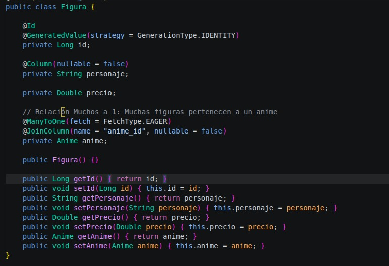
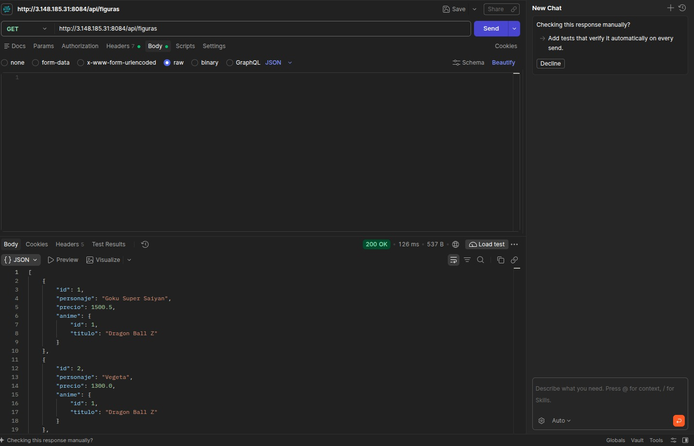
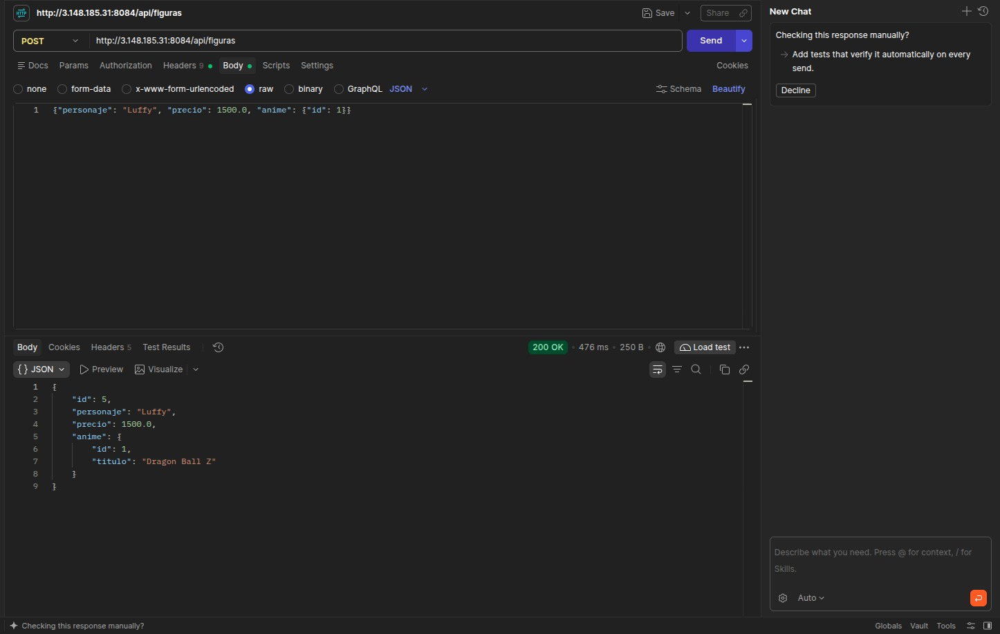
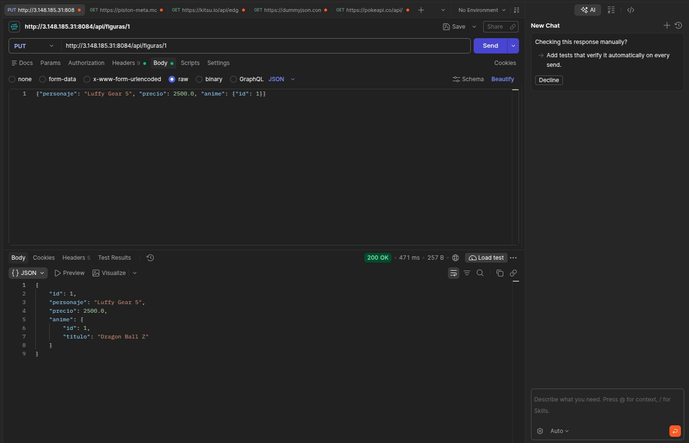
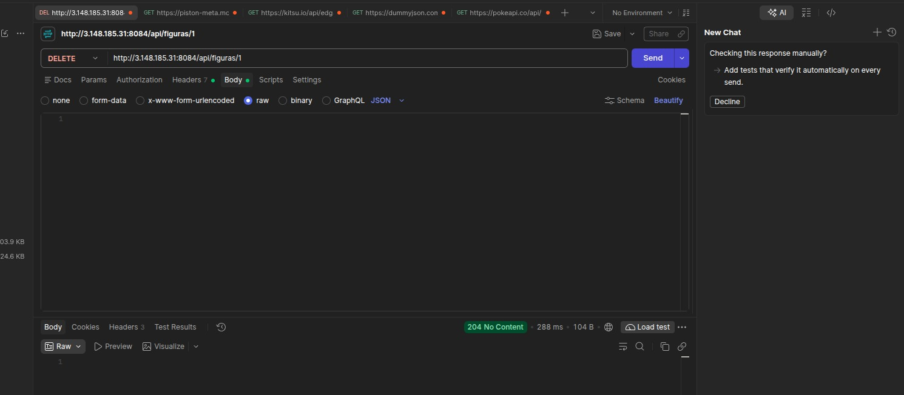

# Actividad 3 - CRUD Spring Boot con JPA y PostgreSQL (SAMact3_t4)

Servicio REST desarrollado en Spring Boot para la gestión de **Animes** y **Figuras**, conectado a PostgreSQL y desplegado en AWS Lightsail.

##  Entidades y Relación (1:N)
El dominio maneja una relación **Uno a Muchos (1:N)**:
- `Anime`: Entidad principal que puede tener múltiples figuras asociadas (`@OneToMany`).
- `Figura`: Entidad dependiente que pertenece a un único anime (`@ManyToOne`).

---

##  Pruebas del CRUD en Postman (VPS: 3.148.185.31:8084)

### 1. Leer (GET /figuras) - Demostración de la relación
Muestra la lista de figuras asociadas, reflejando el objeto `Anime` completo y no solo su ID.

### 2. Crear (POST /figuras)
Inserción de una nueva figura asociándola al `id` de un anime existente.

### 3. Actualizar (PUT /figuras/{id})
Modificación de los atributos de una figura existente.

### 4. Eliminar (DELETE /figuras/{id})
Remoción del registro de una figura por su ID.

---

## Información del Despliegue
- **Host / VPS:** AWS Lightsail (Ubuntu 22.04 LTS)
- **Base de Datos:** PostgreSQL (`figuras_db`)
- **Puerto:** `8084`
- **URL Base:** `http://3.148.185.31:8084/figuras`